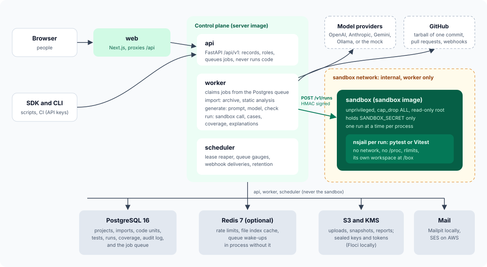
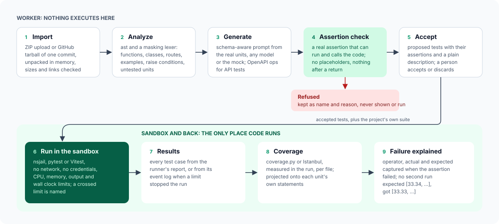

# High-level design

Euron Open TestForge is a self-hosted platform that writes and runs tests for a
developer's own code. A developer imports a GitHub repository or a ZIP of a Python or
JavaScript and TypeScript project; TestForge analyzes the source without running it,
asks a model for unit, edge, negative and API tests grounded in the real code, refuses
every test that has no real assertion before anyone sees it, and runs the accepted tests
(and the project's own suite) in a sandbox with no network, no credentials and a fixed
CPU, memory, output and wall clock budget. Each run reports pass and fail, explains every
failed assertion with the actual and expected values from that same run, and records the
coverage the coverage tool measured.

## Goals and non-goals

| Goals | Non-goals (0.1.0) |
| --- | --- |
| Tests with real assertions grounded in the analyzed source, never stubs that always pass | Languages beyond Python and JavaScript/TypeScript (Java, Go, PHP and others are roadmap) |
| Every execution, generated or uploaded, in a sandbox with no network, no credentials and fixed limits | Browser, visual, load and security test generation |
| Failures explained from the run that produced them, without running the test again | Self-healing tests, exploratory or bug-reproduction agents |
| Real coverage from coverage.py and Istanbul, not an estimate | Kernel-level isolation (gVisor, Kata, microVMs): see [sandbox.md](sandbox.md) |
| Any model provider, or none: a deterministic mock makes everything work without a key | SSO (OIDC, SAML): email and password, plus project API keys |
| Pull requests scoped to the code they change | A published GitHub Action, GitLab integration |

## Components

| Component | What it does | Where |
| --- | --- | --- |
| Web app (`web`) | Next.js 15 dashboard: projects, overview, source explorer, tests, runs, coverage, pull requests, API specs, reports, audit log, settings. Proxies `/api/*` to the API so the browser has one origin and a cookie session | `apps/web/` |
| API (`api`, `testforge serve`) | FastAPI under `/api/v1`. Owns every row; records imports, generations and runs and queues them as jobs. Never runs code, never calls a model on the request path except `POST /bugs/analyze` with `use_model` | `apps/api/src/testforge/` (one package per domain) |
| Worker (`testforge worker`) | Claims jobs from the Postgres queue: imports (GitHub download or ZIP, unpacking, static analysis), generations (prompt, model call, assertion check), runs (through the sandbox service). Up to `WORKER_CONCURRENCY` jobs at once | `worker.py`, `jobs/` |
| Scheduler (`testforge scheduler`) | Periodic tasks: the lease reaper, the queue gauges and `job queue` log line, outbound webhook deliveries, retention | `worker.py`, `jobs/tasks.py` |
| Sandbox (`testforge sandbox`) | The only place TestForge executes code. A small HTTP service that accepts signed run requests from the worker, writes a fresh workspace, runs pytest or Vitest inside nsjail, and returns measurements, the limit crossed if any, the runner's report and the coverage file. Holds no credential but the request signing secret | `sandbox/`, image `infra/docker/sandbox.Dockerfile` |
| Mock services (`mockai`) | Deterministic model providers in the OpenAI, Anthropic, Gemini and Ollama wire formats, a GitHub API serving the demo repositories and pull requests, and a webhook receiver. For tests, e2e and the demo; never deployed to AWS | `apps/api/src/mockai/` |
| Postgres | Everything durable, including the job queue | RDS on AWS |
| Redis | Optional: rate limit windows, the snapshot file index cache, and pub/sub wake-ups. Without `REDIS_URL` each process keeps these in memory | ElastiCache on AWS (`allkeys-lru`) |
| Object storage | Uploaded ZIPs, normalized source snapshots, exported reports | S3 (Floci locally) |
| KMS | Seals model provider keys and headers, GitHub tokens and webhook secrets; encrypts the bucket | KMS (Floci locally) |
| Mail | Member notices | Mailpit locally, SES on AWS |
| GitHub | Repository tarballs, pull requests and their changed files, read only; inbound `pull_request` webhooks | github.com or GitHub Enterprise (the mock locally) |

One Python package holds every role. Two images are built from it: `server.Dockerfile`
(api, worker, scheduler, migrate, CLI and the mock services) and `sandbox.Dockerfile`
(the same package plus nsjail and the read-only test toolchain). See
[ADR-0008](adr/0008-one-package-two-images.md).

## Process roles

| Role | Command | Reaches | Holds |
| --- | --- | --- | --- |
| api | `testforge serve` | Postgres, Redis, S3, KMS, SES, model providers (only for `bugs/analyze` with a model and the provider test button), GitHub (pull request import) | `SESSION_SECRET`, `API_KEY_PEPPER`, the sealing key or KMS, `SANDBOX_SECRET` (the production guard checks it on every role) |
| worker | `testforge worker` | Postgres, Redis, S3, KMS, model providers, GitHub, the sandbox | the same, and it signs sandbox requests with `SANDBOX_SECRET` |
| scheduler | `testforge scheduler` | Postgres, Redis, S3, KMS, webhook receivers | the same |
| sandbox | `testforge sandbox` | nothing: it only answers the worker | `SANDBOX_SECRET` only |
| migrate | `testforge migrate` (one-off) | Postgres | the database URL |

## Flows

### A request

The browser calls the web app's origin; `/api/*` is proxied to the API with the
`tf_session` cookie, and mutations carry `X-TF-CSRF: 1`. Scripts and CI use a bearer
session token or a project API key (`tfk_...`) in `Authorization` or `X-API-Key`. Every
project route resolves a `Principal` (project, role, actor) before anything else: a
project the caller cannot see answers 404 ([security.md](security.md)).

Slow work is never done on the request path. Import, generate and run endpoints write
their record and a `jobs` row in one transaction, publish a wake-up, and return 202. A
caller that wants the result in the same request passes `?wait=<seconds>`: the API listens
on the job's pub/sub channel (and polls Postgres, so a lost message costs one poll) until
the job is final or the wait runs out.

### Importing and analyzing

1. `POST /imports/zip` stores the upload under `uploads/<project>/<import>.zip`;
   `POST /imports/github` records the repository and ref. Either queues an `import` job.
2. The worker fetches the source: the stored ZIP, or GitHub's tarball for the exact
   commit (never a clone, [ADR-0006](adr/0006-github-archives-not-git-clone.md)).
   `sources/archive.py` unpacks it defensively into a map of text files and stores a
   normalized ZIP under `snapshots/<project>/<import>.zip`; the upload is deleted.
3. `analysis/` reads the snapshot without executing anything
   ([ADR-0004](adr/0004-static-analysis-never-executes-code.md)): languages, frameworks,
   test frameworks, dependencies, application objects, and every function, method, class
   and route as a `code_units` row, with which ones no test refers to
   ([analysis.md](analysis.md)).
4. The import becomes `ready` and the project's current import.

### Generating tests

1. `POST /tests/generate` with kinds (`unit`, `edge`, `negative`) and optional unit ids,
   a pull request import, or an OpenAPI document (`api` kind). Without explicit units it
   picks exported units no test touches, up to `MAX_UNITS_PER_GENERATION`.
2. The worker builds a schema-aware prompt from the units' real signatures, parameters,
   docstrings, documented examples, raise conditions and source, and calls the project's
   model provider at temperature 0.
3. Every test in the answer goes through the assertion check
   ([ADR-0003](adr/0003-assertion-check-before-a-test-is-shown.md)). Refused tests leave
   only their name, code and reason on the generation; accepted ones are stored as
   `proposed` with the assertions the check found.
4. For an OpenAPI document, every operation the model skipped gets a test built from the
   document itself, so every documented operation is covered at least once
   ([generation.md](generation.md)).
5. A person (or a `manage` API key) accepts or discards proposed tests.

### Running tests

1. `POST /runs` with kind `generated` (the accepted generated tests only), `project` (the
   project's own suite) or `all` (both), under the project's limits clamped to the
   instance ceilings.
2. The worker sends the snapshot plus the chosen test files to the sandbox service as one
   signed request ([sandbox.md](sandbox.md)).
3. The sandbox runs pytest or Vitest inside a fresh nsjail with no network, under the
   run's CPU, memory, output and wall clock limits, and returns the runner plugin's report,
   its event log and the coverage tool's JSON.
4. The worker stores every test case, explains each failure from the operands the plugin
   captured when the assertion failed, projects coverage onto the import's units, writes
   one `run.finished` audit row and queues `run.finished` webhook deliveries.

## Caching layers

| Layer | What | Where | Key | TTL | Invalidation |
| --- | --- | --- | --- | --- | --- |
| Snapshot file index | Paths, sizes and languages of an import's snapshot (the source explorer's file list) | Redis, or the in-process `MemoryKV` without Redis | `tf:index:<import_id>` | 600 s | None needed: a snapshot never changes after its import is ready; a new import has a new id. A miss rebuilds it from S3; Redis errors count as a miss |
| Static analysis | Code units and the import summary | Postgres (`code_units`, `source_imports.summary`) | the import id | none (rows) | Recomputed only when the import is analyzed again, which replaces that import's units in one transaction |
| Unit coverage | `code_units.covered_percent` from the latest run on that import | Postgres | the unit | none | Overwritten by every run's coverage projection on the same import |
| Runner registry | `runners.yaml` parsed into `Runner` models | in-process `lru_cache` | the file path | process lifetime | Changes only with a new image |
| Settings | Validated `Settings` | in-process `lru_cache` | none | process lifetime | Restart |
| Rate limits | Sliding windows for generations and runs per project; fixed windows for sign-in and sign-up per IP | Redis (atomic Lua script), or in process | `run:<project>`, `generate:<project>`, `login:<ip>`, `signup:<ip>` | the window | Expire on their own |
| In-process cache bound | `MemoryKV` is an LRU with expiry, bounded by entries (2048) and bytes (`MEMORY_CACHE_MAX_BYTES`) | process memory | as above | as above | Least recently used evicted first |
| HTTP | `Cache-Control: no-store` on sign-in and sign-up responses; `private, max-age=300` on report downloads (a report never changes once generated) | response headers | n/a | 300 s for reports | A new report has a new id |
| Web | TanStack Query per view: `live` 2 s (an import, generation or run in progress), `detail` 10 s, `list` 15 s, `config` 60 s, `static` 5 min (a finished run, an import's files) | browser memory | query keys per project | `staleTime` per kind | Mutations invalidate their queries; in-flight records poll at the `live` interval |

The job queue is not a cache and does not live in Redis: it is a Postgres table, so Redis
can run with `allkeys-lru` and lose everything without losing work
([ADR-0005](adr/0005-postgres-job-queue.md)). Unit tests cover the cache's expiry, byte
bound and Redis error fallback (`tests/unit/core/test_kv.py`); the integration suite runs
against real Redis.

## Deployment shapes

| Shape | How | Use |
| --- | --- | --- |
| Local, emulated AWS | `make up`: Compose with Floci provisioned by the same Terraform modules | Development, evaluation, the demo |
| Local against real AWS | `make up-aws` with `deploy/compose/.env.aws` | Testing S3 and KMS for real |
| AWS | `infra/terraform/envs/aws-dev` or `aws-prod`: ECS Fargate (api, worker, scheduler, web) behind an ALB, the sandbox on an EC2 capacity provider, RDS, ElastiCache, S3, KMS, Secrets Manager, SES, CloudWatch | Production ([deploy-aws.md](../guides/deploy-aws.md)) |

The sandbox runs on EC2 because Fargate cannot take the custom seccomp profile nsjail
needs; see [sandbox.md](sandbox.md) and the `sandbox` Terraform module.

## Scaling

| What | How it scales |
| --- | --- |
| API, web | Stateless; N replicas behind the load balancer |
| Worker | N replicas, each running `WORKER_CONCURRENCY` jobs; jobs are claimed with `FOR UPDATE SKIP LOCKED`, so replicas never take the same job |
| Scheduler | One is enough; every task claims its rows or is idempotent, so two are safe |
| Sandbox | One run at a time per sandbox process ([ADR-0002](adr/0002-rlimits-not-cgroups.md)); run more sandbox tasks for more parallel runs. A busy sandbox answers 429 and the worker puts the job back without counting the attempt |
| Postgres | One query per list; indexes on every filter (`ix_jobs_claim`, `ix_jobs_lease`, `(project_id, created_at)` on imports, generations, runs and coverage) |

## Observability

Structured JSON logs with request ids; Prometheus `/metrics` on the API, the worker
(`WORKER_METRICS_PORT`, default 9464) and the sandbox; `/healthz` and `/readyz`; optional
OpenTelemetry tracing (`OTEL_ENABLED`). On AWS, CloudWatch turns the scheduler's
`job queue` line and the worker's `sandbox failure` line into metrics with alarms
([operations.md](../guides/operations.md)).
