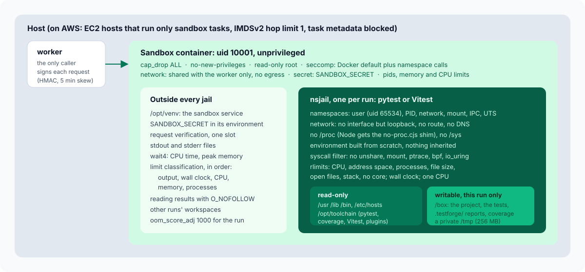

# The sandbox

TestForge runs code it did not write and cannot trust: tests a model wrote, projects
people uploaded, and those projects' own test suites, which import and execute the whole
codebase. Any of them may, by accident or on purpose, open a network connection, read the
platform's credentials or another project's files, fork until the machine stops, print
forever, or sleep forever. The sandbox has four jobs:

1. **Contain**: nothing a run does reaches the network, the platform's services or
   secrets, another run, or the host.
2. **Limit**: CPU time, memory, processes, output, open files and wall clock are bounded
   per run.
3. **Report**: a run that crosses a limit is stopped and named by the limit it crossed,
   and the tests that finished before it are still reported.
4. **Survive**: after any of the above, the next run works.

TestForge reuses Euron Open CodeJudge's unprivileged nsjail design for this, applied to
test runners instead of single programs. The code is `apps/api/src/testforge/sandbox/`:
`server.py` (the service), `jail.py` (one nsjail run), `classify.py` (which limit),
`runners.yaml` (how each framework runs), `protocol.py` (the signed request and result).
The hostile suite in `apps/api/tests/sandbox/` runs inside the real sandbox image with the
production hardening (`make test-sandbox`).

## A separate service, called by the worker

The sandbox is its own process role (`testforge sandbox`) in its own image, not a library
inside the worker. The worker never executes project code itself; it sends the sandbox one
HTTP request per run:

| Endpoint | Purpose |
| --- | --- |
| `POST /v1/runs` | Run a suite. Body: job id, runner (`pytest` or `vitest`), the workspace files (relative path and base64 content), optional targets, whether to collect coverage, and the limits (`cpu_s`, `wall_s`, `memory_mb`, `output_bytes`). Answers with the measurements and the runner's files |
| `DELETE /v1/runs/{job_id}` | Kill a run in progress (the worker's job was cancelled) |
| `GET /healthz` | Liveness, whether nsjail is present, the runners available |
| `GET /metrics` | `testforge_sandbox_runs_total{runner,outcome}` and `testforge_sandbox_run_seconds{runner}` |

Every request carries `X-TF-Sandbox: t=<unix>,v1=<hex HMAC-SHA256(SANDBOX_SECRET,
"<t>.<body>")>`. The service refuses a missing, wrong or stale signature (more than five
minutes of skew) with 401, so only the worker can start or stop a run. The secret is the
only credential the sandbox holds, and it never reaches a run.

Why a service and not a worker that pulls jobs: the worker already owns the job lease, the
database and the model calls; the sandbox should own nothing. Pushing a self-contained
request (all files inline) means the sandbox needs no database, no object storage, no
queue and no route to anything. Its network only has to accept connections from the
worker.

### One run at a time per process

The service holds a semaphore of `SANDBOX_CONCURRENCY` slots (1 in Compose and on ECS). A
request waits up to 30 seconds for a slot and otherwise answers 429; the worker puts the
job back after 5 seconds without counting the attempt. The reason is `RLIMIT_NPROC`: it
counts processes per real uid, and every jail maps to the service's uid, so two concurrent
jails would share one process budget (and count the service's own threads too). Throughput
comes from more sandbox replicas, not more jails per replica
([ADR-0002](adr/0002-rlimits-not-cgroups.md)).

A run ends when it finishes, when it crosses a limit, when the worker hangs up (the
service watches the connection every half second and kills the run's process group), or on
`DELETE /v1/runs/{job_id}`. A second request with the same job id while one is in progress
gets 409.

## Why unprivileged

Most code runners that use a real sandbox (nsjail or isolate with cgroups) run it inside a
**privileged** container, because cgroup v2 needs privilege or a delegated subtree. Then
an escape from the inner sandbox is root in a container that can mount the host's disk.
Judge0's 2024 advisories (CVE-2024-28185, CVE-2024-28189, CVE-2024-29021) became host
takeovers for exactly that reason.

TestForge takes the other road: **the sandbox container has no privileges at all**, and
the per-run jail is built from user namespaces, which an unprivileged process may create.
An escape from the jail lands as uid 10001 in a container with no capabilities, no
credentials and no network route anywhere.
[ADR-0001](adr/0001-unprivileged-nsjail-sandbox-service.md)

## Layer 1: the sandbox container

| Control | Setting | Why |
| --- | --- | --- |
| Capabilities | `cap_drop: ALL` | Nothing to abuse: no `CAP_SYS_ADMIN`, no `CAP_NET_RAW` |
| `no-new-privileges` | on | No setuid binary can raise privileges |
| Seccomp | `infra/docker/sandbox-seccomp.json`: Docker's default profile plus `clone, unshare, mount, umount2, pivot_root, sethostname, setdomainname, setns` without `CAP_SYS_ADMIN` | Docker's default blocks namespace creation for an unprivileged process; these few calls let nsjail build a jail, and the kernel still allows them only inside a new user namespace |
| Root filesystem | read-only | The service and the toolchain cannot be modified, even by the service |
| Scratch | tmpfs `/tmp` (exec, 1 GB, owned by uid 10001) | Each run's workspace lives under `/tmp/testforge-sandbox/<job>` and disappears with it |
| User | uid 10001 | Never root |
| Limits | `pids_limit: 1024`, `mem_limit: 3g` (tmpfs counts as memory), `cpus: 2` | The outer bound on everything below |
| Network | Compose: only the internal `sandbox` network, shared with the worker alone | No Postgres, Redis, API, Floci, object storage, metadata service or internet |
| Environment | `SANDBOX_SECRET`, `LOG_LEVEL`, `SANDBOX_CONCURRENCY` | No database, storage, provider or GitHub setting is ever given to it |

In Compose (`deploy/compose/compose.yaml`) the `sandbox` network is `internal: true`, so it
has no route out at all; the worker is the only other service attached to it. The
integration suite uses a second copy, `sandbox-test` (profile `test`), published on
loopback port 5635 on a network of its own, hardened the same way.

On AWS the `sandbox` Terraform module applies the same rules: ECS tasks on EC2 hosts that
run nothing else, whose Docker daemon uses the sandbox profile as its default seccomp
profile with `no-new-privileges`; privileged containers disabled on the host; capabilities
dropped, read-only root, tmpfs `/tmp`, an nproc ulimit, uid 10001,
`SANDBOX_CONCURRENCY=1`, one task per host; IMDSv2 with a hop limit of 1 and
`ECS_AWSVPC_BLOCK_IMDS`, so a task cannot borrow the instance role; a task role with no
policy and an execution role that injects only `SANDBOX_SECRET`. Its security group allows
ingress on 8080 from the worker's security group only and has **no egress rule at all**.
The worker finds it through Cloud Map (`http://sandbox.<prefix>.internal:8080`). Fargate
cannot take a custom seccomp profile, which is why the sandbox is the one service on EC2.

## Layer 2: nsjail, one jail per run

Every run gets a fresh nsjail (built from the pinned 3.6 release in the image's first
stage), started by `jail.py`:

| Namespace or control | Effect |
| --- | --- |
| User namespace | The run is uid and gid 65534 (nobody) inside, mapped to 10001 outside; no capability means anything outside the namespace |
| PID namespace | It sees only its own processes; killing everything kills only them. When nsjail goes, the namespace goes |
| Network namespace | No interface but loopback, no route: `connect()` fails, DNS fails |
| Mount namespace | Read-only `/usr`, `/lib`, `/lib64` (where it exists), `/bin`, `/etc/alternatives`, `/etc/ld.so.cache`, `/dev/null`, `/dev/zero`, `/dev/urandom`; the test toolchain read-only at `/opt/toolchain`; an `/etc/hosts` that knows only `localhost`; the run's workspace writable at `/box`; a private tmpfs `/tmp` (256 MB). Nothing else exists: no `/etc/passwd` or `/etc/resolv.conf`, no `/opt/venv` (the service), no other run's workspace, no `/proc`, no `/sys`, no `/root` or `/home` |
| IPC and UTS | Private; hostname `testforge` |
| Environment | `PATH=/usr/bin:/bin`, `LANG=C.UTF-8`, `HOME=/tmp`, `TMPDIR=/tmp`, plus the runner's own `env` entries. Nothing from the service is inherited (no `SANDBOX_SECRET`) |
| CPU | `--max_cpus 1` |
| Working directory | `/box` |

### The syscall filter on the run

The outer profile has to allow namespace calls so nsjail can build the jail; tests never
need them. A kafel policy, applied by nsjail just before `exec`, makes them fail inside:

- `EPERM` for `unshare`, `setns`, `mount`, `umount`, `pivot_root`, `chroot`, `ptrace`,
  `process_vm_readv`, `process_vm_writev`, `bpf`, `keyctl`, `add_key`, `request_key`,
  `perf_event_open`, `userfaultfd`, `io_uring_setup`, `io_uring_enter`,
  `io_uring_register`, `kexec_load`, `init_module`, `finit_module`, `delete_module`,
  `swapon`, `swapoff`, `reboot`, `acct`, `open_by_handle_at`, `name_to_handle_at`,
  `quotactl`, `syslog`, `settimeofday`, `clock_settime`, `clock_adjtime`.
- `ENOSYS` for `clone3`, so the C library falls back to `clone`, which threads (and so
  Node and Python's thread pools) still need.

### Limits from rlimits

| Limit | nsjail flag and value | Catches |
| --- | --- | --- |
| CPU | `--rlimit_cpu`: the run's `cpu_s` plus 1 s | Busy loops: `SIGXCPU`, then `SIGKILL` at the hard limit |
| Wall clock | `--time_limit`: the run's `wall_s` | Tests that sleep, wait on a socket or block forever |
| Address space | `--rlimit_as`: `memory_mb` plus the runner's `memory_overhead_mb` for `address` runners (pytest: 128 MB of overhead); unlimited for `rss` runners (Vitest) | Memory bombs fail to allocate (`MemoryError`) |
| Processes | `--rlimit_nproc`: the runner's `processes` (pytest 128, Vitest 512) | Fork and thread bombs stop at the limit |
| Output | `--rlimit_fsize`: the run's `output_bytes`, rounded up to whole MB | Output floods: writes past it fail |
| Open files | `--rlimit_nofile 256` | Descriptor exhaustion |
| Stack | `--rlimit_stack 64` (MB) | |
| Core dumps | `--rlimit_core 0` | |

For Node, whose V8 reserves far more address space than it uses, an address-space limit
would make every run fail at start. The Vitest runner is `memory_mode: rss`: the heap is
capped with `--max-old-space-size={mem}` through `NODE_OPTIONS`, the peak resident memory
(plus 256 MB of overhead for Node, Vitest and esbuild) is checked after the run, and the
container's memory limit is the backstop. Before `exec`-ing nsjail the service raises the
run's `oom_score_adj` to 1000 (allowed without privilege), so under memory pressure the
kernel kills the run, not the service.

The weakness of rlimits, a per-uid process count, is closed by running one jail at a time
per service process (above).

### No /proc, and the Node shim

Docker overmounts parts of a container's `/proc`, and the kernel then refuses to mount a
fresh procfs inside a user namespace, so nsjail cannot give the jail a `/proc` without
privileges. The jail runs with `--disable_proc`. pytest and coverage.py do not need it.
Node does in one place: `process.memoryUsage()` reads `/proc/self/statm`, and Vitest calls
it between test files, where the `ENOENT` would leave it waiting forever.
`toolchain/js/no-proc.cjs`, loaded into every Node process with `NODE_OPTIONS=--require`,
wraps `process.memoryUsage()` (and `.rss()`): every field stays exact when the original
works, and when it throws, the resident size comes from `process.resourceUsage().maxRSS`
(getrusage, no `/proc` needed) and the heap fields from `v8.getHeapStatistics()`. Vitest
runs with `pool: forks` and a single fork, so every Node process gets the heap cap and the
shim from `NODE_OPTIONS` (worker threads would not).
[ADR-0009](adr/0009-no-proc-in-the-sandbox.md)

## The runners

`sandbox/runners.yaml` is read by the API and the worker (which framework a language uses)
and by the sandbox (how to run it), so a framework the API offers is one the sandbox runs.

| Runner | Languages | Command | Coverage | Memory |
| --- | --- | --- | --- | --- |
| `pytest` | Python | `/opt/toolchain/python/bin/python -m pytest -c /box/.testforge/pytest.ini --rootdir=/box -p testforge_pytest -p no:cacheprovider --import-mode=importlib -q`, plus targets | `--cov=/box` with a generated `coveragerc`, JSON to `/box/.testforge/coverage.json` (coverage.py) | `address`, 128 MB overhead, 128 processes |
| `vitest` | JavaScript, TypeScript | `/usr/bin/node /opt/toolchain/js/node_modules/vitest/vitest.mjs run --config /box/.testforge/vitest.config.mjs` | `--coverage.enabled=true`, Istanbul JSON to `/box/.testforge/coverage/coverage-final.json` | `rss`, 256 MB overhead, 512 processes |

Before a run the service writes the runner's configuration into `/box/.testforge/`
(`pytest.ini` and `coveragerc`, or `vitest.config.mjs` with the test globs, excludes,
`includeTaskLocation`, Istanbul with `all: true`, and TestForge's reporter). Python runs
get `PYTHONPATH=/opt/toolchain/plugins:/box:/box/src`, `PYTHONDONTWRITEBYTECODE=1` and
`PYTHONHASHSEED=0`. For Vitest, `/box/node_modules` is a fresh directory of symlinks to
the toolchain's packages, so tests resolve `vitest` while the packages themselves stay
read-only.

### The read-only toolchain

The sandbox image installs everything a run may use under `/opt/toolchain`, at build time
and pinned:

- `python/`: a virtualenv with pytest, pytest-cov, coverage and the libraries a typical
  service under test imports (FastAPI, httpx, Pydantic, Flask, requests), pinned in
  `toolchain/python/requirements.txt`. API tests drive the application object in process
  (`TestClient`, `test_client()`), never over a network.
- `js/`: Vitest 3.2.4 and `@vitest/coverage-istanbul`, pinned in `package-lock.json`, plus
  `testforge-reporter.mjs` and `no-proc.cjs`.
- `plugins/testforge_pytest.py`: TestForge's pytest plugin.

Runs never install anything: they have no network. A project that needs a library the
toolchain lacks fails to import it, and the run reports that as a collection error.

### What the plugins record

The pytest plugin and the Vitest reporter write only under `/box/.testforge`:

- `events.jsonl`, appended as things happen: `start` when a test begins, `result` when it
  ends (outcome, duration, location, failure), `collect_error` for a file that does not
  load.
- `report.json` at the end: every test with its outcome and failure, collection errors,
  the exit status, the duration.
- For a failed comparison, the operator and both operands **as the framework saw them**:
  pytest's `pytest_assertrepr_compare` hook receives the real values before they become
  text; Vitest's `TestError` carries `actual` and `expected`. This is what lets a failure
  be explained without running the test again ([generation.md](generation.md)).

## The per-run workspace

`write_workspace` builds `/tmp/testforge-sandbox/<job>/box` from the request:

- Every path must be relative, without `..`, backslashes, NUL or empty segments (checked
  when the request is parsed and again on disk with `resolve()`); the first segment may not
  be `.testforge` or `node_modules`, which the sandbox writes itself.
- Contents must be valid base64; the workspace may not exceed 60 MB; a file may not
  replace a directory or a symlink.
- After the run the whole work directory is removed, restoring permissions first if the
  run `chmod`-ed its own files to 000.

## Reading the results back without trusting them

The run can write anything under `/box`, including replacing `report.json` with a symlink
to a file only the service may read. `read_output` therefore opens each path component
with `O_NOFOLLOW` relative to the directory before it (`dir_fd`), opens the leaf with
`O_NOFOLLOW | O_NONBLOCK`, accepts it only if `fstat` says it is a regular file, and reads
at most a fixed size (`report.json` 5 MB, `events.jsonl` 2 MB, the coverage file 30 MB).
Anything else reads as absent. stdout and stderr are files outside the jail; only their
last 16 000 bytes are returned.

## Measuring

The service starts nsjail through `/bin/sh -c 'echo 1000 > /proc/self/oom_score_adj;
exec "$@"'` in a new session, so the process it waits for is nsjail itself, and waits with
`os.wait4`. The `rusage` of nsjail includes every descendant it reaped, which is the whole
run: CPU time is `ru_utime + ru_stime`, peak memory is `ru_maxrss`. A timer five seconds
past the wall limit kills the process group if nsjail itself hangs.

nsjail reports a child killed by a signal as exit status 128 plus the signal, and exits
with 255 when it cannot launch at all. The service recognises a launch failure first
(status 255 and nsjail's "Couldn't launch the child process"), returns it as a sandbox
`error` (the worker counts it as a sandbox failure, not a test result), and only then reads
129 to 192 as signals.

## Which limit was crossed

`classify.py` decides from the measurements, the tails of stdout and stderr, the failure
lines of the event log and nsjail's log, in this order:

1. **output**: stdout or stderr reached the output limit, the run got `SIGXFSZ`, or the
   text says `File too large` or `EFBIG`. First on purpose: once a write is cut at
   `RLIMIT_FSIZE`, a runtime may spin or fail in ways that look like a timeout.
2. **wall_clock**: nsjail logged that the run time reached the limit, or the wall time ran
   more than 4 seconds past it.
3. **cpu**: the measured CPU time passed the limit, or the run got `SIGXCPU`.
4. **memory**: the text shows an out-of-memory error (`MemoryError`, `heap out of memory`,
   `Cannot allocate memory`, `ERR_WORKER_OUT_OF_MEMORY`, `std::bad_alloc`); or, for an
   `rss` runner, the peak resident memory passed the limit plus the runner's overhead; or
   the run was killed with `SIGKILL` at 90% of the memory limit or more.
5. **processes**: the text shows a refused fork or thread (`Resource temporarily
   unavailable`, `can't start new thread`, `EAGAIN`, `fork: retry`).

No limit crossed means no limit, whatever the exit status: failing tests are not a limit.
Each limit comes with a plain sentence ("The tests used 12.4 s of CPU time, over the 10 s
limit, and were stopped"), stored as the run's message.

## The event log survives a stopped run

A run stopped at a limit usually never writes `report.json`. The worker then rebuilds the
cases from `events.jsonl`: every `result` line is a finished test with its real outcome,
and a test with a `start` but no `result` is the one that was running when the limit hit,
recorded as an `error` whose failure names the limit. A developer sees which tests passed,
which failed, and exactly which test was stopped, instead of one opaque timeout.

## What this does not protect against

- **Kernel vulnerabilities reachable through namespaces.** User namespaces widen the
  kernel's attack surface. The syscall filter removes the common entry points (`unshare`,
  `io_uring`, `bpf`, `userfaultfd`), and an escape still lands unprivileged, with no
  network and no credential but the signing secret, but it is not impossible. For a
  deployment where anyone on the internet can upload code, add a kernel boundary (gVisor
  `runsc`, Kata Containers or a microVM) around the sandbox containers, or run them on
  dedicated hosts, and keep the kernel patched.
- **The signing secret after an escape.** An escaped run that reads the service's
  environment holds `SANDBOX_SECRET`, which lets it call the sandbox, nothing else: the
  sandbox network reaches no other service. Rotate it after any suspected escape.
- **Side channels** between runs on one host are not addressed; one run per process and
  `--max_cpus 1` reduce, not remove, them.
- **What the tests do inside their own workspace.** A test can delete or rewrite its own
  copy of the project; that copy is thrown away after the run.

Report sandbox escapes privately: [SECURITY.md](../../SECURITY.md).
